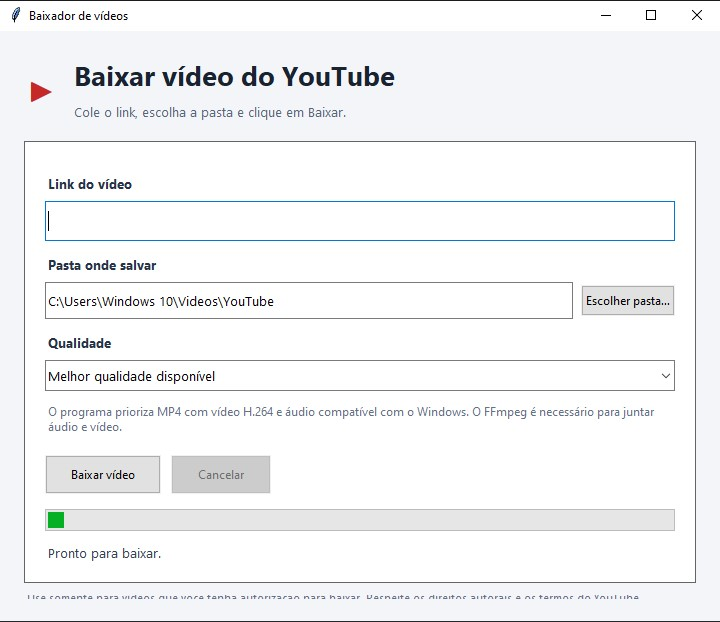

# BaixadorYouTube


Aplicativo de interface gráfica para Windows, desenvolvido em Python com Tkinter, que permite informar um link, escolher a qualidade do vídeo e definir a pasta de destino.

## 1. Requisitos para desenvolver

Computador com Windows 10 ou Windows 11, preferencialmente 64 bits, acesso à internet e os seguintes programas:

- Python
- yt-dlp
- FFmpeg
- PyInstaller

## 2. Instalar e verificar o Python

Instale o Python para Windows, se ainda não estiver instalado.

Abra o Prompt de Comando (CMD) e execute:

```bat
py --version
```

No ambiente de desenvolvimento utilizado, a versão era Python 3.15.1.

## 3. Instalar o yt-dlp

O yt-dlp é o componente responsável pelo download.

Instale com o Winget:

```bat
winget install yt-dlp.yt-dlp
```

Verifique a instalação:

```bat
yt-dlp --version
```

Versão registrada durante o desenvolvimento: 2026.10.21.

## 4. Instalar o FFmpeg

O FFmpeg é utilizado para combinar áudio e vídeo quando necessário.

Instale pelo Winget:

```bat
winget install yt-dlp.FFmpeg
```

Verifique se os executáveis estão disponíveis:

```bat
where ffmpeg
where ffprobe
```

Confirme também:

```bat
ffmpeg -version
```

O programa utiliza `ffmpeg.exe` e `ffprobe.exe` na distribuição final.

## 5. Criar a pasta do projeto

Crie uma pasta para os arquivos de desenvolvimento. Exemplo:

```text
C:\BaixadorYouTube
```

O nome da pasta pode ser diferente, desde que os comandos seguintes sejam executados no local correto.

## 6. Criar o código Python

Dentro da pasta do projeto, crie o arquivo:

```text
baixador.py
```

Esse arquivo contém o código-fonte da aplicação, desenvolvido com Python e Tkinter.

A interface inclui:

- Campo para informar o link do vídeo.
- Seleção da pasta de destino.
- Opções de qualidade.
- Botão para iniciar o download.
- Botão para cancelar.
- Indicador de progresso e mensagens de status.
- Tratamento de erros e avisos.

O programa executa o yt-dlp como um processo separado e utiliza uma fila de mensagens para atualizar a interface.

**Importante:** mantenha no GitHub o código-fonte que foi efetivamente testado. A versão do arquivo `baixador.py` deve ser a mesma que você deseja compilar.

## 7. Instalar o PyInstaller

No CMD, execute:

```bat
py -m pip install --upgrade pyinstaller
```

Verifique a instalação:

```bat
py -m PyInstaller --version
```

Versão registrada durante o desenvolvimento: PyInstaller 6.22.3.

## 8. Gerar o executável

Entre na pasta do projeto:

```bat
cd /d C:\BaixadorYouTube
```

Confirme que o arquivo existe:

```bat
dir baixador.py
```

Gere o executável:

```bat
py -m PyInstaller --clean --onefile --windowed --name BaixadorYouTube baixador.py
```

Significado dos parâmetros:

- `--clean`: limpa arquivos temporários do PyInstaller.
- `--onefile`: gera um único executável para o código Python e suas dependências empacotáveis.
- `--windowed`: evita abrir uma janela de console junto com a interface gráfica.
- `--name BaixadorYouTube`: define o nome do executável.

Ao terminar, o executável será criado em:

```text
C:\BaixadorYouTube\dist\BaixadorYouTube.exe
```

## 9. Preparar a pasta de distribuição

Copie para a pasta `dist` os executáveis do yt-dlp e do FFmpeg.

A estrutura final esperada é:

```text
BaixadorYouTube/
├── BaixadorYouTube.exe
├── yt-dlp.exe
├── ffmpeg.exe
└── ffprobe.exe
```

Os três programas auxiliares devem ser compatíveis com o Windows do cliente e estar junto do executável principal.

Os caminhos originais do yt-dlp e do FFmpeg podem ser encontrados usando `where yt-dlp`, `where ffmpeg` e `where ffprobe`.

## 10. Testar a distribuição

Antes de entregar ao cliente:

1. Copie a pasta completa para outro local.
2. Abra `BaixadorYouTube.exe`.
3. Informe um link de vídeo autorizado para download.
4. Escolha a qualidade e a pasta de destino.
5. Inicie o download.
6. Verifique se o arquivo foi criado corretamente.
7. Abra o vídeo e confira se possui imagem e som.
8. Teste também as mensagens de erro e o cancelamento.

Sempre que modificar `baixador.py`, gere novamente o executável e repita os testes.

## 11. Entregar ao cliente

Copie a pasta completa para um pendrive ou outro meio de transferência.

No computador do cliente, o programa precisa de:

- Windows compatível.
- Conexão com a internet.
- Espaço livre para armazenar os vídeos.
- Os quatro arquivos da pasta de distribuição.

O cliente não precisa instalar Python ou PyInstaller, nem instalar separadamente o yt-dlp ou o FFmpeg, desde que os respectivos executáveis estejam presentes e o programa consiga localizá-los.

## 12. Manutenção

Para atualizar o yt-dlp, obtenha a versão atualizada do executável, teste-a e substitua o arquivo na pasta de distribuição.

Se atualizar o código Python, compile novamente com o comando da etapa 8.

Mantenha uma cópia do código-fonte e registre as alterações feitas em cada versão.

## 13. Observações

- O formato MP4 não garante compatibilidade com todos os reprodutores: isso também depende dos codecs utilizados.
- O aplicativo precisa de internet para acessar os conteúdos.
- Alguns vídeos podem apresentar restrições de acesso, autenticação ou indisponibilidade.
- Utilize o aplicativo somente para conteúdos que você tenha autorização para baixar e respeite os direitos autorais e os termos aplicáveis do YouTube.

## 14. Tecnologias

- Python
- Tkinter
- yt-dlp
- FFmpeg
- PyInstaller
- Windows

